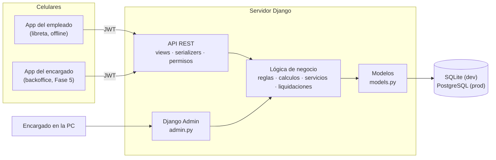
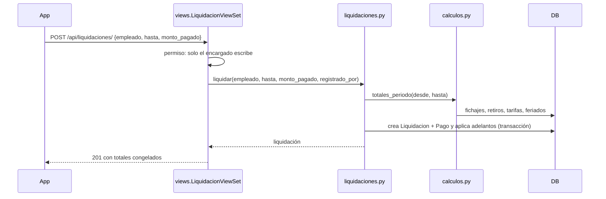

# Arquitectura del BackEnd

## Vista general



Hay dos puertas de entrada que comparten la misma lógica:

- **API REST** (`/api/`): la usa la app Android. Autenticación con JWT.
- **Django Admin** (`/admin/`): la usa hoy el encargado desde la PC. Cuando exista el backoffice móvil (Fase 5), va a convivir con él.

La regla de oro: **ninguna regla de negocio vive en las vistas ni en el admin.** Vistas y admin validan
la forma de los datos y llaman a funciones de `reglas`, `calculos`, `servicios` o `liquidaciones`.

## Estructura de carpetas

```
config/                    Proyecto Django: settings, urls raíz, wsgi/asgi
agenda/                    Única app del sistema (el label "agenda" se mantiene por las migraciones)
├── models.py              Entidades y validaciones propias de cada modelo (clean, validar_eliminable)
├── reglas.py              Validaciones de negocio reutilizables (secuencia, tolerancia, máximo diario…)
├── calculos.py            Cuentas: tramos, horas, ganado, saldo, estado de pago, hoja del día
├── servicios.py           Operaciones del empleado con auditoría y notificación (registrar/anular/modificar)
├── liquidaciones.py       Liquidaciones por período, adelantos, anulaciones y diferencias
├── serializers.py         Entrada/salida JSON de la API
├── views.py · urls.py     Endpoints REST
├── permisos.py            EsEncargado, EncargadoEditaTodosLeen
├── admin.py               Pantallas del encargado (formularios con motivo y auditoría)
├── tests.py               58 tests (cálculos, reglas, API, servicios, liquidaciones, hoja del día)
├── migrations/            0001…0005
└── management/commands/
    └── seed_agenda.py     Datos iniciales y de ejemplo (idempotente)
```

## Responsabilidad de cada módulo

| Módulo | Qué hace | Ejemplos |
|---|---|---|
| `models.py` | Estructura y restricciones que dependen de un solo registro | Una tarifa que ya empezó a regir no se modifica; un feriado pasado no se toca; `Producto.save()` guarda un código vacío como `NULL` |
| `reglas.py` | Reglas que cruzan registros, sin efectos secundarios | `validar_secuencia`, `evaluar_tolerancia`, `validar_motivo`, `dentro_del_plazo`, `validar_maximo_diario`, `validar_dia_no_liquidado` |
| `calculos.py` | Cuentas puras sobre los datos (no guardan nada) | `armar_tramos`, `calcular_ganado`, `saldo_hasta`, `estado_pago_por_dia`, `resumen_dia` |
| `servicios.py` | Operaciones con transacción: validan, guardan, auditan y notifican | `registrar_fichaje`, `anular_fichaje_empleado`, `registrar_retiro`, `modificar_retiro_empleado`, `anular_retiro_empleado` |
| `liquidaciones.py` | Todo el ciclo de pago | `previsualizar`, `liquidar`, `anular`, `registrar_adelanto`, `anular_pago`, `diferencia` |
| `admin.py` | Formularios del encargado | Pide "Motivo de la corrección", bloquea días liquidados, escribe la auditoría |
| `views.py` | Endpoints REST | Traducen `ValidationError` a `{"detalle": ...}` |

> **Nota:** las operaciones de `servicios.py` ya están implementadas y probadas, pero todavía no tienen
> endpoint: la app las va a usar cuando se sincronice con el servidor (**Fase 4**). Hoy los fichajes y
> retiros del celular quedan guardados en el teléfono.

## Recorrido de un pedido

Ejemplo: el encargado liquida a un empleado desde la API.



Si algo no se puede hacer, la lógica lanza `django.core.exceptions.ValidationError` con un mensaje
pensado para el usuario final; la vista lo devuelve como `400 {"detalle": [...]}` (o `409` cuando es un
conflicto, por ejemplo eliminar algo protegido). Ver [API REST](api.md#errores).

## Decisiones de diseño

- **UUID como clave primaria** en todo lo que se crea en el celular (fichajes, retiros), para que el
  teléfono genere el id sin conexión y no haya choques al sincronizar. El resto también usa UUID por uniformidad.
- **Nada se borra.** Fichajes, retiros, pagos y liquidaciones se *anulan*; tarifas y feriados que ya
  rigieron no se modifican. Así los montos del pasado nunca cambian sin dejar rastro.
- **Valores congelados.** El precio del producto se congela en el retiro; el multiplicador del feriado,
  en el feriado; los totales, en la liquidación.
- **Saldos calculados, no guardados.** El saldo y el estado de pago de cada día se recalculan; así una
  corrección o un movimiento que llega tarde se refleja solo.
- **Fecha y hora propias.** Cada movimiento tiene su fecha y hora "de la hoja" (lo que ordena la libreta)
  y aparte el `registrado_en` técnico (cuándo se cargó en el dispositivo) y `recibido_en` (cuándo llegó al servidor).
- **Encargado = superusuario.** Al guardar un `Usuario` con rol `ENCARGADO` se le dan `is_staff` e
  `is_superuser`: es el dueño del sistema.
- **La app replica la lógica.** `calculos.py` y `reglas.py` están replicados en Kotlin en el FrontEnd
  (`dominio/`), con el mismo redondeo, para que la libreta calcule sin conexión. Si cambiás una regla
  acá, hay que cambiarla allá (ver [Cómo aportar](como-aportar.md#reglas-replicadas-en-la-app)).

## Configuración

`config/settings.py` lee variables de entorno:

| Variable | Default (desarrollo) | Producción |
|---|---|---|
| `AGENDAPP_SECRET_KEY` | clave de desarrollo | **obligatoria**, secreta |
| `AGENDAPP_DEBUG` | `1` | `0` |
| `AGENDAPP_ALLOWED_HOSTS` | `*` | dominio(s) del servidor, separados por coma |

Idioma `es-ar`, zona horaria `America/Argentina/Buenos_Aires`. JWT: acceso 12 h, refresco 30 días
con rotación. La base de producción (PostgreSQL) y el despliegue se definen en la Fase 7.
