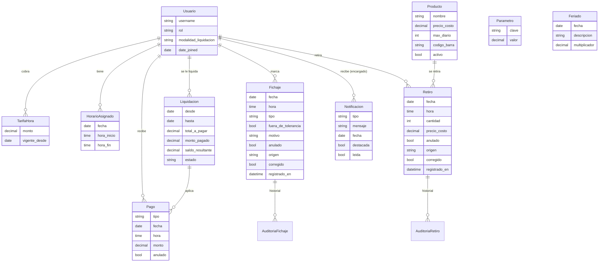

# Modelo de datos

Todas las entidades están en `agenda/models.py`. Las claves son UUID (salvo `Usuario`, `Parametro` y
`Notificacion`, que usan el id entero de Django).

## Entidades

### Usuario
Extiende el usuario de Django (`AUTH_USER_MODEL = "agenda.Usuario"`).

| Campo | Significado |
|---|---|
| `rol` | `ENCARGADO` o `EMPLEADO`. Un encargado queda automáticamente como staff y superusuario. |
| `modalidad_liquidacion` | `DIARIA`, `SEMANAL`, `QUINCENAL`, `MENSUAL` o `TRIMESTRAL`: el período que se sugiere al liquidar. |
| `date_joined` | La fecha de alta: desde ahí arranca la primera liquidación. |

### Parametro
Valores configurables, con default si no están cargados (`Parametro.obtener(clave)`):

| Clave | Default | Uso |
|---|---|---|
| `tolerancia_minutos` | 15 | Margen para fichar sin motivo respecto del horario asignado |
| `anulacion_fichaje_minutos` | 10 | Plazo del empleado para anular un fichaje o modificar/anular un retiro |
| `multiplicador_feriado` | 2 | Multiplicador que toma un feriado nuevo si no se indica otro |

### Feriado
Fecha única, descripción y **multiplicador propio** (copiado del parámetro al crearlo). Uno de fecha
pasada no se crea, modifica ni elimina (`clean` / `validar_eliminable`).

### Producto
`nombre` único, `precio_costo`, `max_diario` (por empleado y por día; 0 = sin límite), `codigo_barra`
opcional y único (vacío se guarda como `NULL`), `activo`. No se maneja stock. Eliminarlo desde la API
es una baja lógica: queda inactivo y los retiros históricos lo siguen referenciando.

### TarifaHora
Historial de monto por hora de cada empleado (`vigente_desde`, única por empleado y fecha). Una tarifa nueva
rige desde hoy en adelante **y** después del último fichaje del empleado. Solo se modifica o elimina si
todavía no empezó a regir.

### HorarioAsignado
Tramos esperados por día (puede haber varios: mañana y tarde). Inicio < fin (no cruzan la medianoche) y
sin superposición con otro tramo del mismo día.

### Fichaje
Una marca de `ENTRADA` o `SALIDA`. Los tramos trabajados se arman de a pares (entrada → salida).

| Campo | Significado |
|---|---|
| `fecha`, `hora` | Lo que muestra y ordena la hoja |
| `fuera_de_tolerancia`, `motivo` | Si quedó fuera de horario, el motivo es obligatorio |
| `anulado`, `anulado_en` | Anulado = no suma; nunca se borra |
| `origen` | `EMPLEADO` (desde su celular) o `ENCARGADO` (cargado por el encargado) |
| `corregido` | Lo creó o modificó el encargado (la app lo marca con un lápiz) |
| `registrado_en` | Momento exacto en que se registró en el dispositivo (el plazo corre desde acá) |
| `recibido_en` | Momento en que llegó al servidor |

### Retiro
Producto, cantidad y **`precio_costo` congelado** al retirar. `subtotal = precio_costo × cantidad`. Mismos
campos de estado y origen que el fichaje.

### AuditoriaFichaje / AuditoriaRetiro
Cada alta, modificación o anulación hecha por el encargado (o por el empleado dentro del plazo) deja una
fila con `datos_anteriores`, `datos_nuevos`, usuario, fecha y `motivo` (obligatorio si fue el encargado).
Son de solo lectura.

### Pago
Dinero entregado al empleado ("Recibido" en la libreta).

- `ADELANTO`: entregado sin liquidar. Queda pendiente (`liquidacion` vacía) hasta que la próxima liquidación lo descuenta.
- `LIQUIDACION`: el pago hecho al liquidar.
- Se anulan con motivo; nunca se borran.

### Liquidacion
Período contiguo `desde`–`hasta` de un empleado, con los totales **congelados**: `saldo_anterior`,
`minutos_trabajados`, `ganado`, `retiros`, `adelantos`, `total_a_pagar`, `monto_pagado`,
`saldo_resultante`. Estado `VIGENTE` o `ANULADA` (con quién, cuándo y motivo).

### Notificacion
Aviso al encargado de lo que registran los empleados (entrada, salida, retiro, fichaje anulado, retiro
modificado o anulado). `destacada` = fuera de horario. Se marca como leída.

## Migraciones

| Migración | Contenido |
|---|---|
| 0001 | Modelo inicial |
| 0002 | Retiros, auditoría y notificaciones |
| 0003 | Historial de tarifas y feriados (multiplicador propio) |
| 0004 | Liquidaciones, pagos y hora propia de cada movimiento |
| 0005 | `Producto.codigo_barra` (Fase 3) |

Toda modificación de modelos va con su migración (`python manage.py makemigrations agenda`) y en el
mismo commit. Ver [Cómo aportar](como-aportar.md#migraciones).
