# Guía del encargado

Esta guía explica cómo administrar AgendApp: cargar productos, tarifas y horarios, revisar y corregir lo
que registran los empleados, entregar adelantos y liquidar.

Hoy el encargado trabaja desde la **PC, en el panel de administración** (las capturas son del sistema
real con datos de ejemplo). El backoffice en el celular llega en la Fase 5, con las mismas funciones.

> **Cómo se relaciona con la app de los empleados:** cada empleado anota en su celular sus entradas,
> salidas y los productos que retira; la app calcula lo que ganó y su saldo. Vos definís con qué datos
> calcula (tarifas, horarios, precios, feriados) y registrás lo que le pagás.

---

## 1. Entrar

Abrí en el navegador la dirección del servidor seguida de `/admin/` (en la red local, por ejemplo
`http://192.168.0.154:8000/admin/`) e ingresá con tu usuario y contraseña.

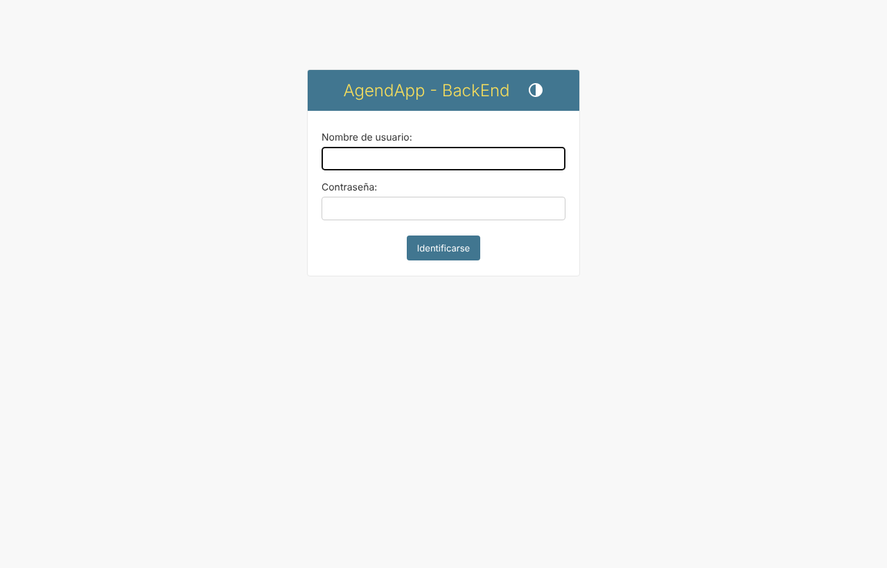

A la izquierda está el menú con todas las secciones. **Agregar** abre directamente el formulario para
cargar uno nuevo; el nombre de la sección abre la lista.

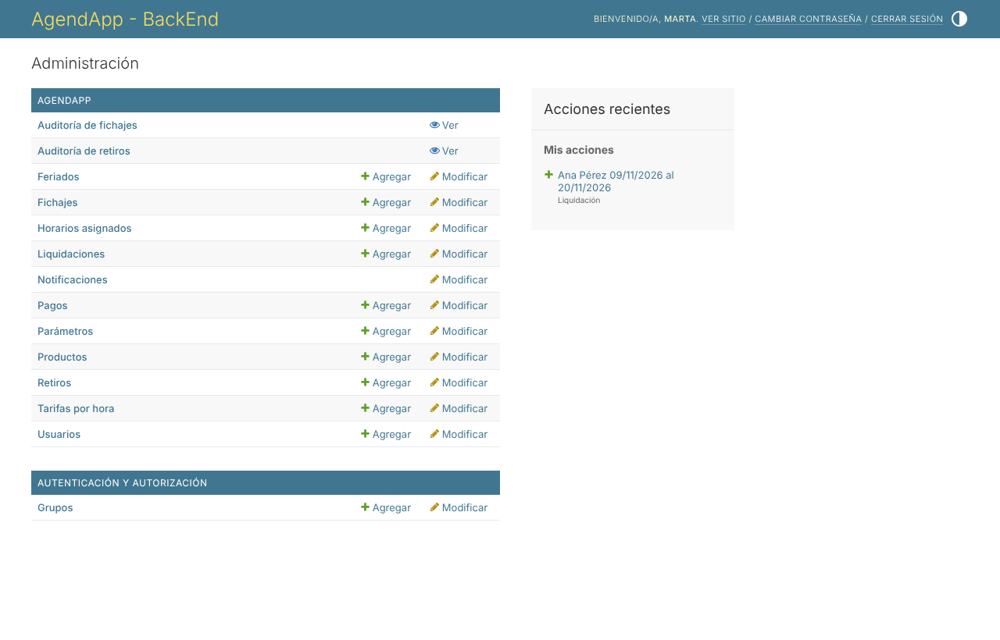

---

## 2. Empleados (Usuarios)

**Usuarios → Agregar**: usuario y contraseña, nombre y apellido, **Rol** (*Empleado* o *Encargado*) y
**Modalidad de liquidación** (diaria, semanal, quincenal, mensual o trimestral): es el período que el
sistema te va a sugerir al liquidar.

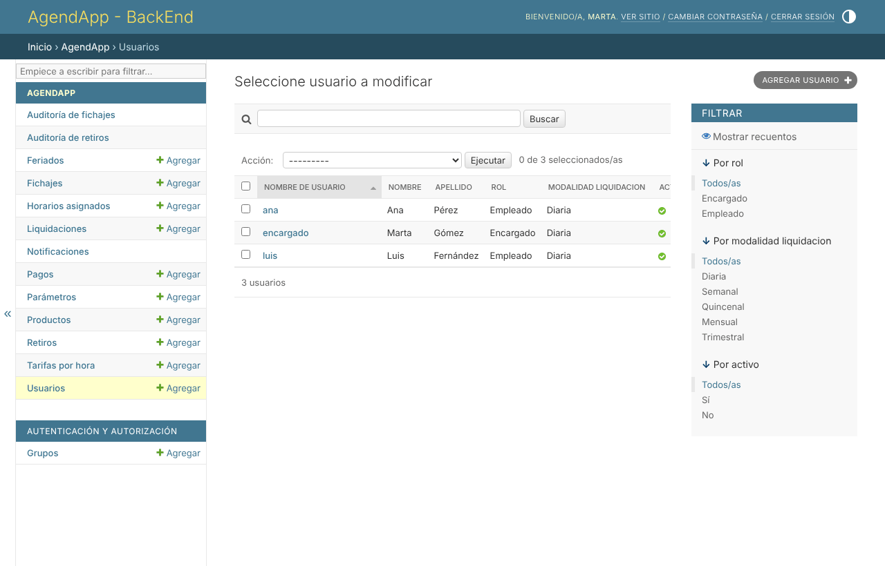

- La fecha de alta es el primer día que se le liquida.
- Un empleado que deja de trabajar no se borra: destildá **Activo** y ya no puede ingresar. Su historial se conserva.

---

## 3. Productos

**Productos** lista lo que los empleados pueden retirar, con su precio de costo, el máximo por día y el
código de barras.

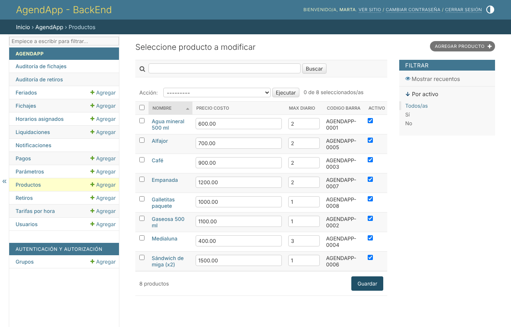

Al cargar o editar un producto:

| Campo | Para qué |
|---|---|
| **Precio costo** | Lo que se le descuenta al empleado por unidad. Si lo cambiás, los retiros anteriores conservan el precio que tenían. |
| **Max diario** | Cuántas unidades puede retirar cada empleado por día. `0` = sin límite. |
| **Código barra** | El código de barras o el texto del QR del producto, para que el empleado lo escanee con el celular. Opcional. |
| **Activo** | Destildalo para que deje de aparecer en la app (no se borra). |

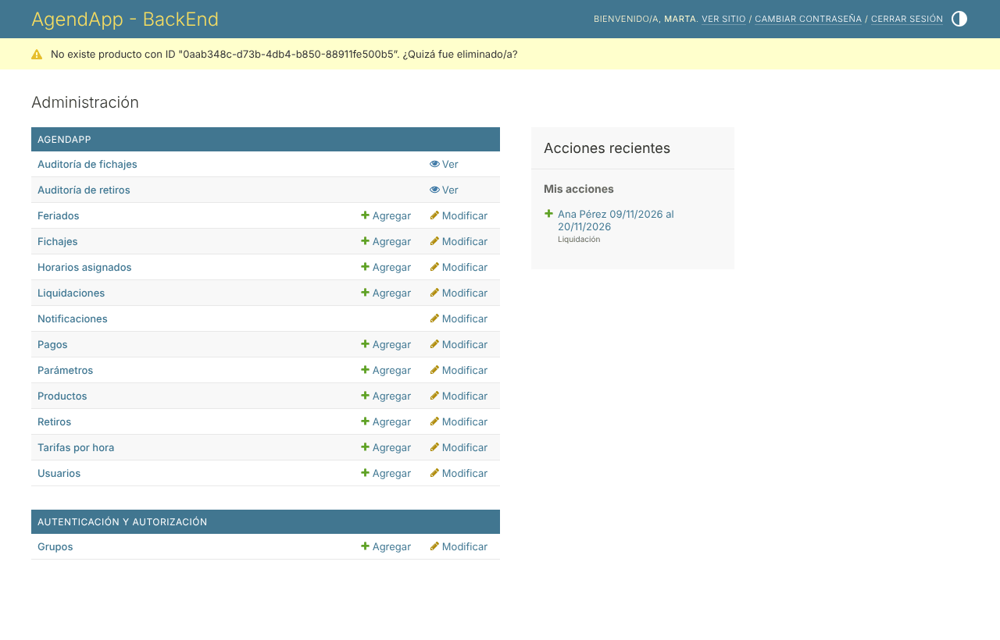

---

## 4. Tarifas por hora

Cada empleado tiene un **historial** de tarifas: cuánto cobra la hora desde una fecha.

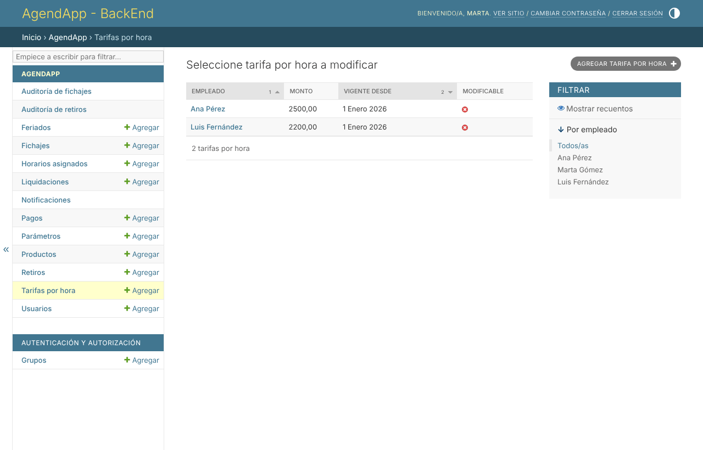

- Para **aumentar** a un empleado, cargá una **tarifa nueva** con la fecha desde la que rige. No se edita la anterior: así lo ya trabajado se sigue pagando como corresponde.
- La fecha de una tarifa nueva tiene que ser **de hoy en adelante** y posterior al último día que el empleado fichó.
- Una tarifa que todavía no empezó a regir sí se puede corregir o eliminar (columna *Es modificable*).

---

## 5. Horarios asignados

El horario esperado de cada empleado por día. Puede haber **varios tramos** en el mismo día (por ejemplo,
08:00–12:00 y 16:00–20:00). Los horarios no pueden cruzar la medianoche ni superponerse.

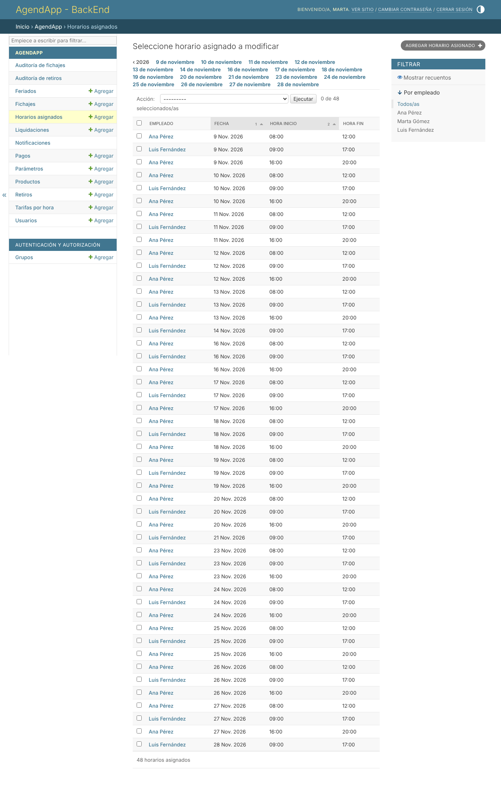

Para qué sirven:

- La app le muestra al empleado su horario del día.
- Si ficha **más de 15 minutos** antes o después (la tolerancia, ver Parámetros), la app le pide un **motivo**, y vos recibís el aviso destacado.
- Un día **sin horario** también le pide motivo.
- Se pagan las **horas reales** trabajadas, no las del horario.

---

## 6. Feriados y parámetros

**Feriados**: en un feriado la hora vale más (por defecto, el doble). Cada feriado guarda su propio
multiplicador, así un cambio futuro no altera lo ya pagado. Los feriados pasados no se modifican.

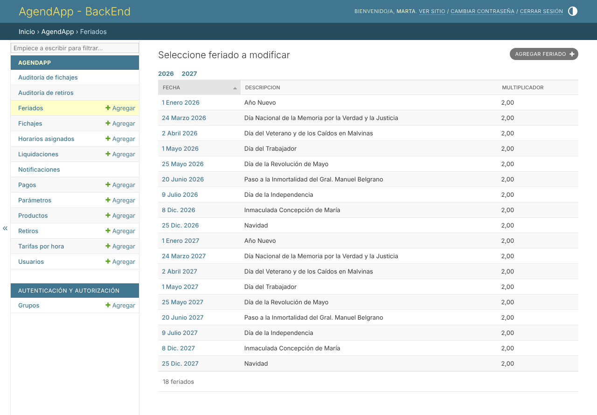

**Parámetros**: valores generales del sistema.

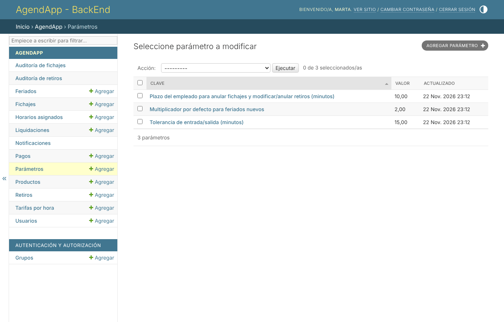

| Parámetro | Por defecto | Qué controla |
|---|---|---|
| Tolerancia de entrada/salida | 15 min | Margen para fichar sin motivo |
| Plazo del empleado | 10 min | Tiempo que tiene el empleado para anular un fichaje o cambiar un retiro |
| Multiplicador por defecto para feriados | 2 | Cuánto vale la hora en un feriado nuevo |

---

## 7. Revisar y corregir fichajes

**Fichajes** muestra las entradas y salidas de todos los empleados. A la derecha podés filtrar por
empleado, tipo, anulados, corregidos o **fuera de tolerancia**; arriba, por fecha.

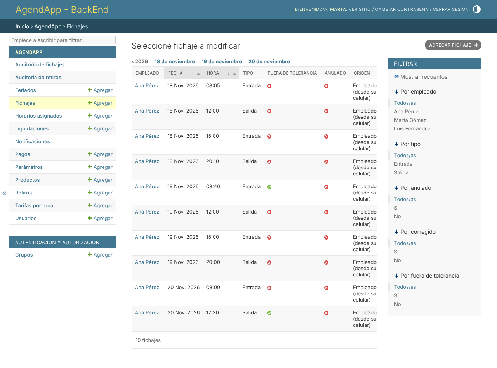

### Corregir uno

Abrí el fichaje, cambiá lo necesario (hora, tipo, motivo o tildá **Anulado**) y completá el
**Motivo de la corrección**, que es obligatorio y queda en la auditoría. Abajo ves el historial de
cambios.

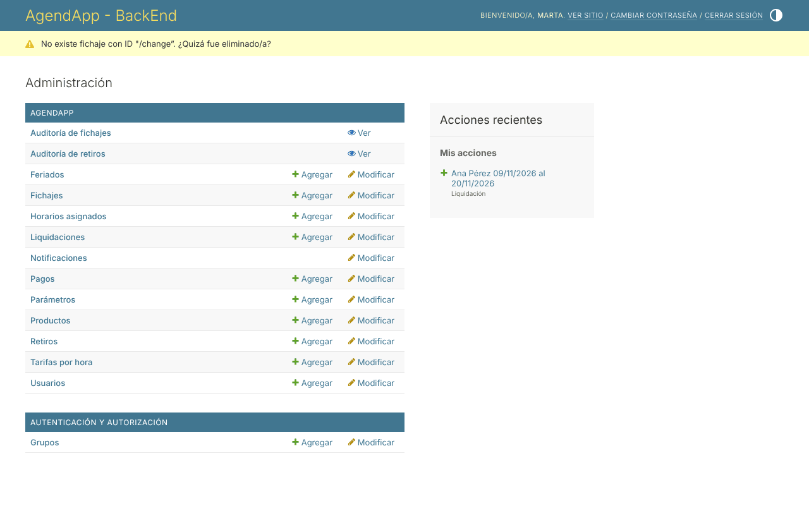

### Cargar un fichaje olvidado

**Fichajes → Agregar**: empleado, fecha, hora, tipo y motivo de la corrección. La fecha viene con la de
hoy, pero **la hora viene vacía a propósito**: casi siempre se carga un fichaje olvidado, con una hora
anterior, y una hora precargada que no se cambia pagaría horas que no se trabajaron. Si es de este
momento, usá el atajo **Ahora**. En retiros y adelantos, la fecha y la hora vienen con las actuales. En la libreta del
empleado aparece con un **lápiz** al margen, para que sepa que lo cargaste vos.

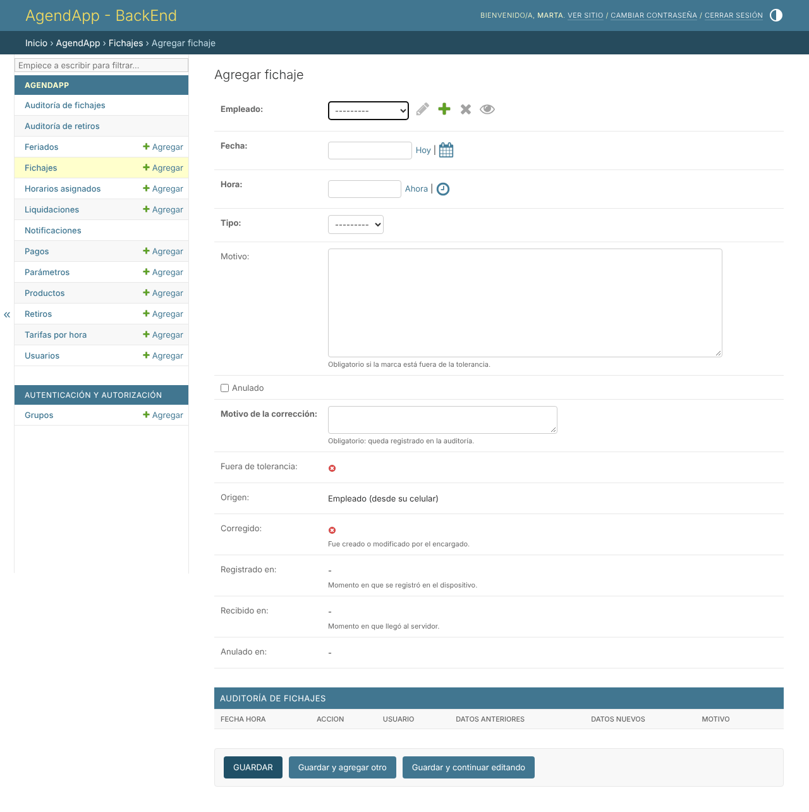

En los desplegables de empleado aparecen solo los empleados (no el encargado), incluidos los inactivos,
para poder corregirles movimientos o liquidarlos.

Reglas que el sistema controla por vos:

- Las marcas del día tienen que alternar entrada → salida, sin dos a la misma hora.
- **No se puede cargar ni corregir un día ya liquidado.** Primero anulá la liquidación (ver punto 10).
- Nada se borra: un fichaje equivocado se **anula** y queda tachado.

---

## 8. Retiros de productos

**Retiros** lista lo que retiró cada empleado, con el precio que tenía el producto ese día y el subtotal.
Se corrige igual que un fichaje: abrir, cambiar producto o cantidad (o anular) y escribir el motivo.

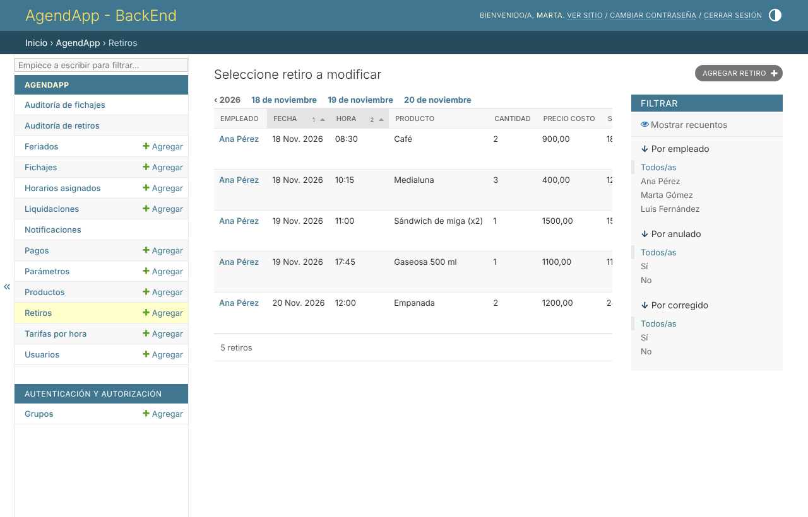

El empleado puede corregir o anular sus propios retiros durante los primeros 10 minutos desde que los
carga; después, solo vos.

---

## 9. Adelantos

Cuando le das dinero a un empleado **sin liquidar**, registralo en **Pagos → Agregar**: empleado, fecha,
hora y monto. Al empleado le aparece en su libreta como **Recibido**, y la próxima liquidación lo
descuenta automáticamente.

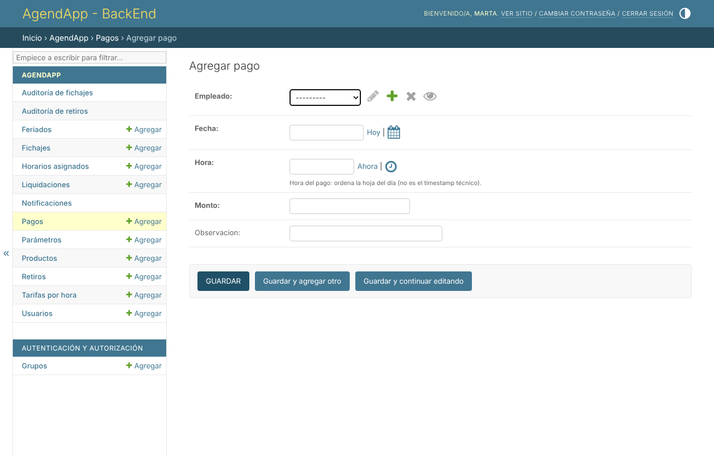

En la lista de pagos se ve si cada uno ya quedó aplicado a una liquidación o sigue pendiente. Un pago
equivocado se **anula** (con motivo), no se borra.

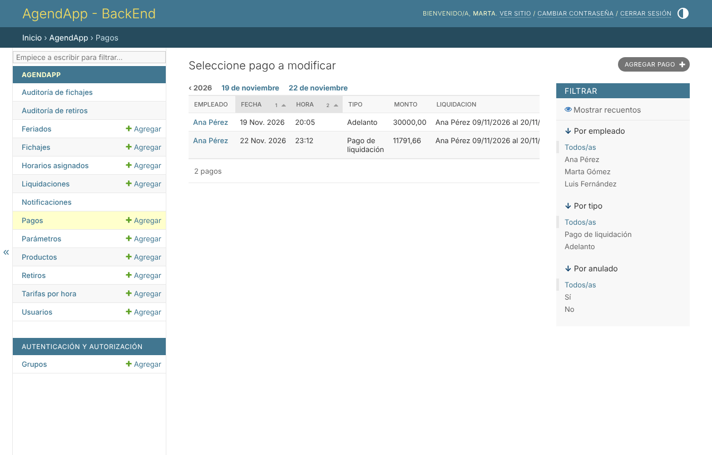

---

## 10. Liquidar

Liquidar es cerrar un período de un empleado y registrar cuánto le pagaste.

**Liquidaciones → Agregar**:

1. Elegí el **empleado**.
2. **Hasta**: el último día que liquidás. Si lo dejás vacío, el sistema usa el sugerido según la modalidad del empleado. El **desde** lo pone el sistema: el día siguiente a la liquidación anterior (no quedan días sin liquidar).
3. **Monto pagado**: lo que le entregás. Puede ser **menos que el total**: lo que falta queda como saldo para la próxima.
4. Fecha y hora del pago: vacías = ahora.

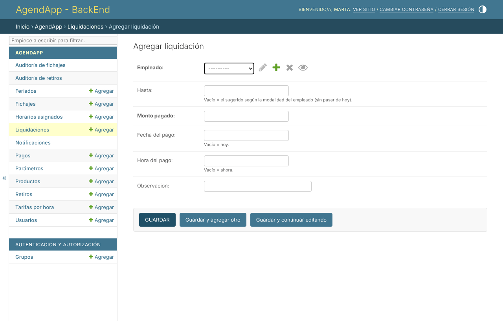

El sistema calcula y guarda la cuenta:

```
Total a pagar = Saldo anterior + Ganado − Productos retirados − Adelantos
Saldo resultante = Total a pagar − Monto pagado
```

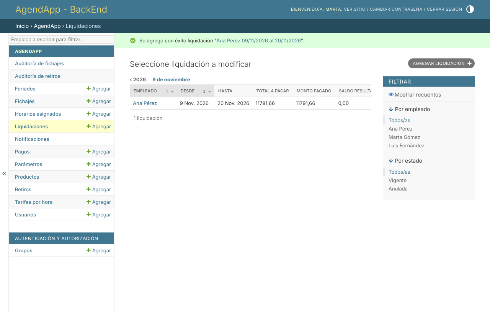

En el detalle ves todos los totales y qué pagos quedaron aplicados (el adelanto y el pago de la
liquidación). En el ejemplo: Ana trabajó del 9 al 20 de noviembre, ganó $49.791,66, retiró productos por
$8.000 y ya tenía un adelanto de $30.000: le corresponden $11.791,66.

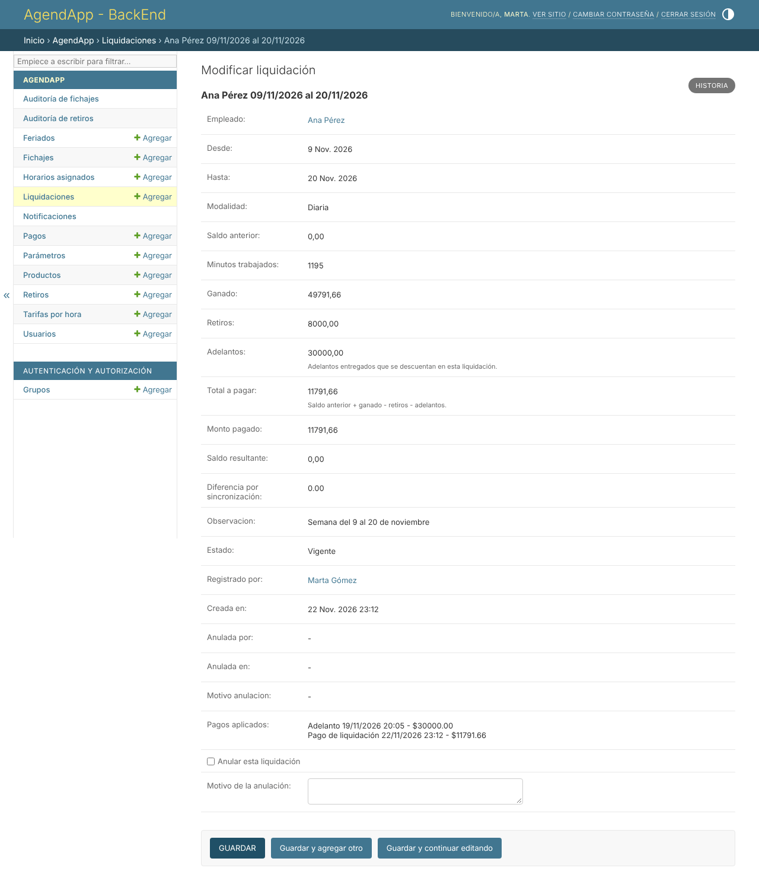

### Anular una liquidación

Si hay que corregir un día liquidado: abrí la **última** liquidación del empleado, tildá
**Anular esta liquidación**, escribí el motivo y guardá. Los días se desbloquean y los pagos vuelven a
quedar pendientes (el dinero ya se entregó, así que se descuenta cuando vuelvas a liquidar).

### Si algo llega tarde

Si el celular de un empleado estuvo sin conexión y sincroniza movimientos de un período ya liquidado, se
aceptan igual (ya ocurrieron). La diferencia se ve en el detalle de esa liquidación y se suma o resta
sola en la siguiente.

---

## 11. Notificaciones y auditoría

**Notificaciones**: cada vez que un empleado ficha, retira, anula o modifica algo, te llega un aviso.
Los fichajes **fuera de horario** llegan destacados, con el motivo que escribió el empleado.

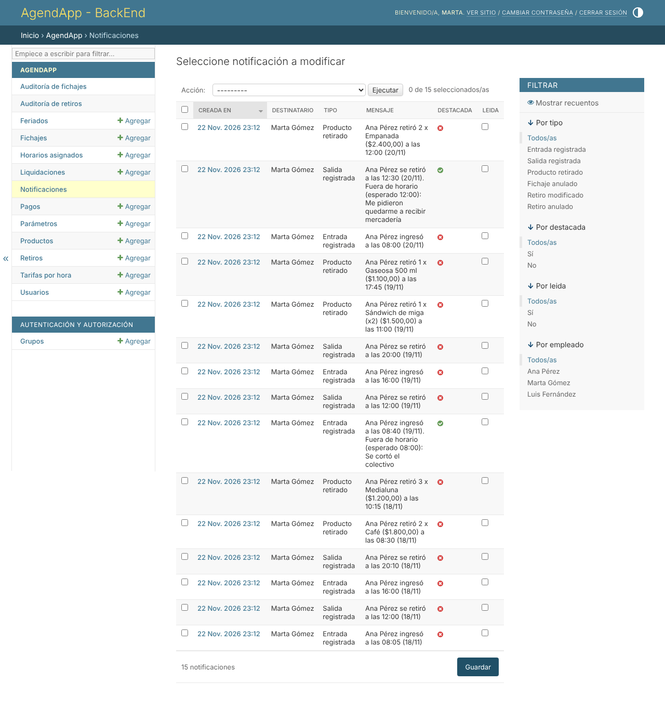

**Auditoría de fichajes / de retiros**: el registro de todas las correcciones, con quién las hizo, cuándo,
el motivo y los datos antes y después. Es de solo lectura.

> Los avisos de lo que registran los empleados en el celular empiezan a llegar cuando la app sincronice
> con el servidor (Fase 4).
